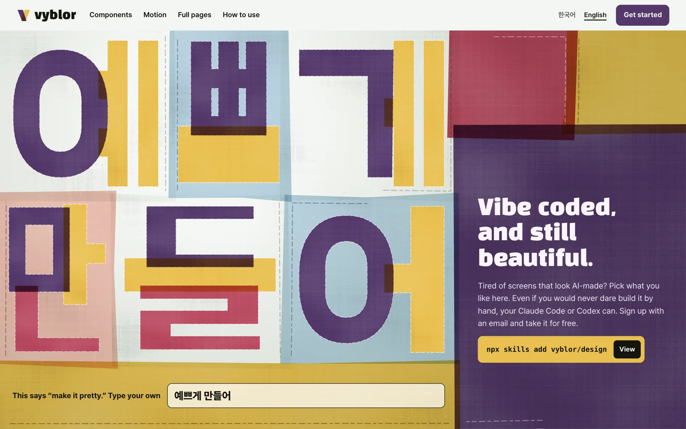
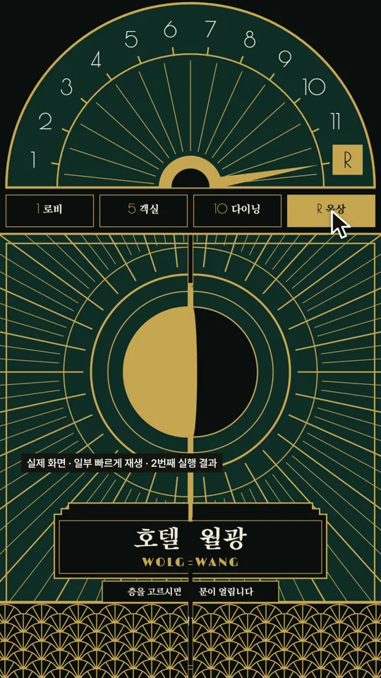
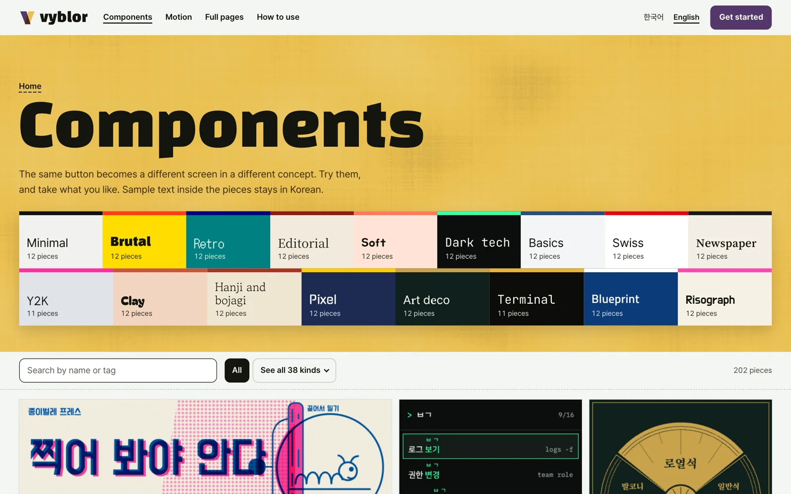
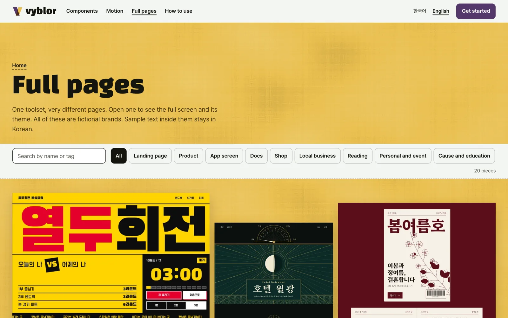

<p align="center">
  <a href="https://vyblor.com/en"></a>
</p>

<h1 align="center">Vyblor design skill</h1>

<p align="center"><strong>Vibe coded, and still beautiful.</strong><br>
Design judgement for coding agents such as Claude Code and Codex, so that what they build stops looking machine-made.</p>

<p align="center">
  <a href="README.md">한국어</a> · English
</p>

<p align="center">
  <a href="https://vyblor.com/en">Website</a> ·
  <a href="https://vyblor.com/en/components">Components</a> ·
  <a href="https://vyblor.com/en/motion">Motion</a> ·
  <a href="https://vyblor.com/en/pages">Full pages</a> ·
  <a href="https://vyblor.com/en/docs">Docs</a>
</p>

## Start in 30 seconds

```sh
npx skills add vyblor/design
```

Then ask your agent the way you normally would.

```text
Use the vyblor skill and build a landing page
```

No sign-in, no account and no API key.

| For | Command |
|---|---|
| Claude Code | `npx skills add vyblor/design --agent claude-code --yes` |
| Codex | `npx skills add vyblor/design --agent codex --yes` |
| Update | `npx skills update vyblor --yes` |
| Remove | `npx skills remove vyblor --yes` |

## What the skill does

Agents write code well, but their design tends to drift back to the same few answers. This skill tells them what to decide before building, and which habits to avoid.

| Area | What it covers | File |
|---|---|---|
| Type | Choosing fonts, the size scale, line length | [`type.md`](skills/vyblor/references/type.md) |
| Colour | The order of colour decisions, contrast, dark mode | [`colour.md`](skills/vyblor/references/colour.md) |
| Space | Spacing, composition, layout across screen sizes | [`space.md`](skills/vyblor/references/space.md) |
| Motion | Whether to move at all, timing, curves, reduced motion | [`motion.md`](skills/vyblor/references/motion.md) |
| States | Hover, focus, errors, empty screens, loading | [`states.md`](skills/vyblor/references/states.md) |
| Copy | Interface text that reads as written by a person | [`copy.md`](skills/vyblor/references/copy.md) |
| Korean | Line breaking, line height, fonts, mixing Hangul and Latin | [`korean.md`](skills/vyblor/references/korean.md) |
| Library | When and how to bring in Vyblor pieces | [`library.md`](skills/vyblor/references/library.md) |

The skill is plain text. There are no scripts, no install hooks and no telemetry. You can read every step an agent follows in [`skills/vyblor/SKILL.md`](skills/vyblor/SKILL.md).

## What it looks like in use

This is a hotel page's prompt, copied from Vyblor and pasted into Claude Code. The film's captions are in Korean.

<p align="center">
  <a href="https://github.com/Vyblor/design/releases/download/film-2026-11-02/vyblor-threads-intro.mp4"></a><br>
  <a href="https://github.com/Vyblor/design/releases/download/film-2026-11-02/vyblor-threads-intro.mp4">Watch the full film (35 seconds, MP4)</a>
</p>

| One plain sentence | The Vyblor prompt |
|---|---|
|  |  |

Neither result was edited by a person. The right one is the second of two runs of the same prompt. The first came out with its floor scenes blank, so a complex page may not work first time. The film speeds up the waiting.

## Faster still: the library

The skill gives judgement. The pieces themselves are in the [Vyblor library](https://vyblor.com/en). Try the live work, then take it as a prompt, HTML or React.

| | |
|---|---|
| [](https://vyblor.com/en/components) | [](https://vyblor.com/en/motion) |
| **[Over 200 components](https://vyblor.com/en/components)** in 38 kinds and 17 concepts | **[Over 140 motion pieces](https://vyblor.com/en/motion)** live code and rendered films |
| [](https://vyblor.com/en/pages) | [](https://vyblor.com/en/pages/art-deco-grand-hotel) |
| **[20 full pages](https://vyblor.com/en/pages)** that really work | **[Detail view](https://vyblor.com/en/pages/art-deco-grand-hotel)** desktop, phone, colours and fonts |

Copying and saving need a free account. Sign up with a 6-digit code sent to your email.

## Three ways to connect

| | Skill (this repository) | MCP | CLI |
|---|---|---|---|
| What it does | Gives design judgement | Lets your agent search and fetch the library itself | Finds pieces and saves them to files from a terminal |
| Account | Not needed | Needed (API key) | Needed (API key) |
| Start | `npx skills add vyblor/design` | [Vyblor/mcp](https://github.com/Vyblor/mcp) | [Vyblor/cli](https://github.com/Vyblor/cli) |

They work best together: the skill sets the direction, and MCP or the CLI brings in real pieces.

## Questions

**Can I use only the skill?** Yes. It works without an account.

**Is it React only?** No. The skill works with any framework, and library pieces come as a prompt, plain HTML or React.

**Does it send my code anywhere?** The skill is text and sends nothing by itself.

**Where is the full guide?** The [docs](https://vyblor.com/en/docs) cover everything from installing to connecting.

## Licence

The skill text is under the [MIT licence](LICENSE). The Vyblor library, its pieces, its name, its logo, and the screenshots and film in this README are not covered by that licence. Library pieces are covered by the [terms](https://vyblor.com/terms): free to use in personal and commercial projects, and not to be redistributed as a library, template, kit or dataset.
