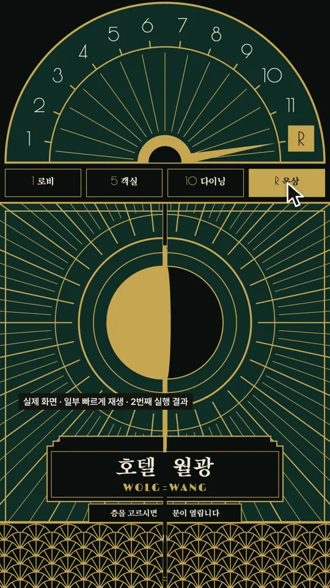
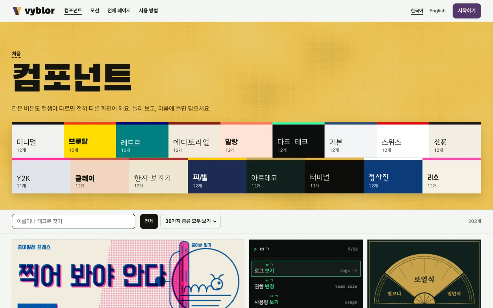
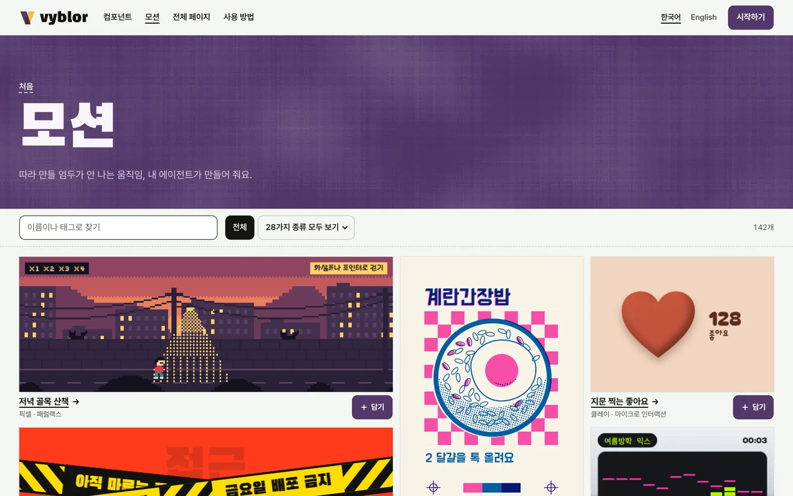
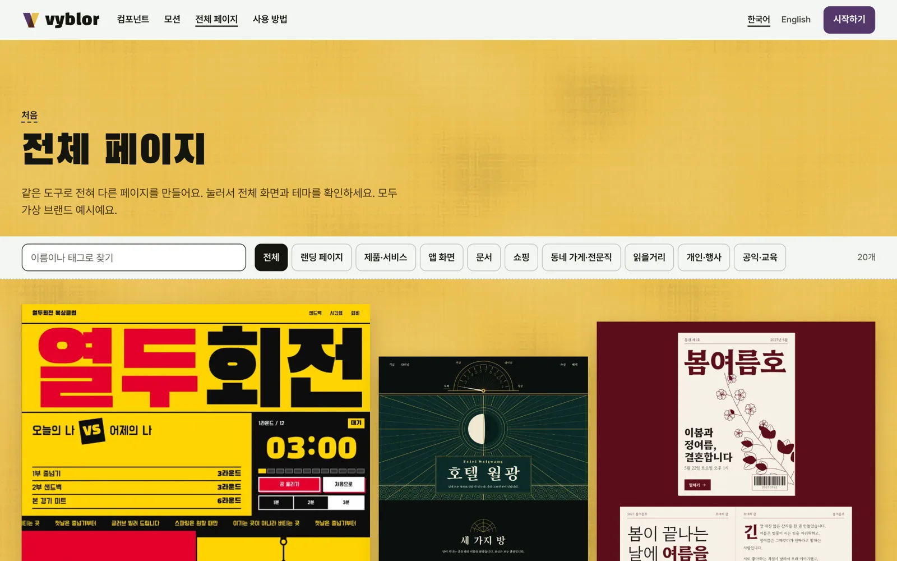
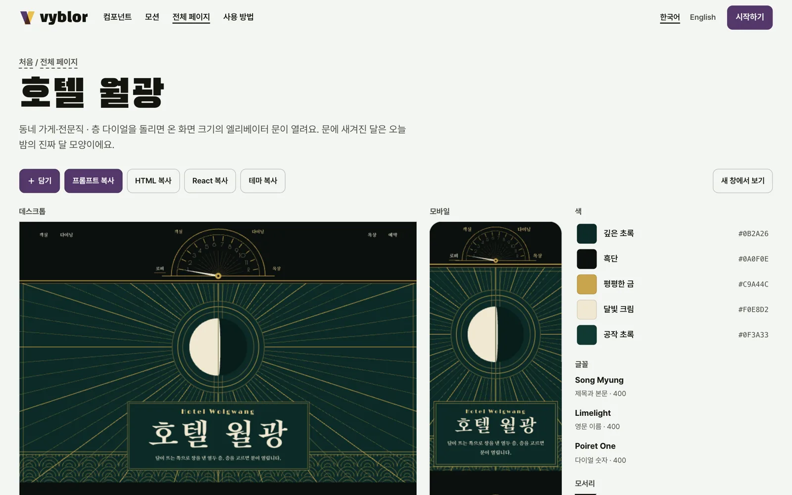

<p align="center">
  <a href="https://vyblor.com"></a>
</p>

<h1 align="center">Vyblor 디자인 스킬</h1>

<p align="center"><strong>바이브 코딩으로도, 예쁘게.</strong><br>
AI가 만든 티를 줄이는 디자인 판단을 Claude Code와 Codex 같은 코딩 에이전트에게 알려 줘요.</p>

<p align="center">
  한국어 · <a href="README.en.md">English</a>
</p>

<p align="center">
  <a href="https://vyblor.com">웹사이트</a> ·
  <a href="https://vyblor.com/components">컴포넌트</a> ·
  <a href="https://vyblor.com/motion">모션</a> ·
  <a href="https://vyblor.com/pages">전체 페이지</a> ·
  <a href="https://vyblor.com/docs">사용 방법</a>
</p>

## 30초 만에 시작하기

```sh
npx skills add vyblor/design
```

설치한 뒤 에이전트에게 평소처럼 말하면 돼요.

```text
vyblor 스킬로 랜딩 페이지 만들어 줘
```

로그인도, 계정도, API 키도 필요 없어요.

| 쓰는 도구 | 설치 명령 |
|---|---|
| Claude Code | `npx skills add vyblor/design --agent claude-code --yes` |
| Codex | `npx skills add vyblor/design --agent codex --yes` |
| 업데이트 | `npx skills update vyblor --yes` |
| 삭제 | `npx skills remove vyblor --yes` |

## 이 스킬이 하는 일

에이전트는 코드는 잘 쓰지만, 디자인은 늘 비슷한 답으로 돌아가곤 해요. 이 스킬은 만들기 전에 무엇을 먼저 정할지, 어떤 습관을 피할지 알려 줘요.

| 다루는 것 | 내용 | 파일 |
|---|---|---|
| 글자 | 글꼴 선택, 크기 단계, 줄 길이 | [`type.md`](skills/vyblor/references/type.md) |
| 색 | 색을 정하는 순서, 대비, 다크 모드 | [`colour.md`](skills/vyblor/references/colour.md) |
| 공간 | 간격, 구성, 화면 크기별 배치 | [`space.md`](skills/vyblor/references/space.md) |
| 모션 | 움직일지 말지, 시간, 곡선, 움직임 줄이기 | [`motion.md`](skills/vyblor/references/motion.md) |
| 상태 | 호버, 포커스, 오류, 빈 화면, 로딩 | [`states.md`](skills/vyblor/references/states.md) |
| 문구 | 사람이 쓴 것처럼 읽히는 화면 문구 | [`copy.md`](skills/vyblor/references/copy.md) |
| 한글 | 줄바꿈, 줄 간격, 글꼴 선택, 한글과 영문 섞어 쓰기 | [`korean.md`](skills/vyblor/references/korean.md) |
| 라이브러리 | Vyblor 조각을 언제 어떻게 가져올지 | [`library.md`](skills/vyblor/references/library.md) |

스킬은 글로만 되어 있어요. 스크립트도, 설치 훅도, 텔레메트리도 없어요. 에이전트가 따르는 순서는 [`skills/vyblor/SKILL.md`](skills/vyblor/SKILL.md)에서 전부 읽어 볼 수 있어요.

## 실제로 쓰면 이렇게 돼요

Vyblor에서 호텔 페이지의 프롬프트를 복사해 Claude Code에 붙여 넣은 과정이에요.

<p align="center">
  <a href="https://github.com/Vyblor/design/releases/download/film-2026-11-02/vyblor-threads-intro.mp4"></a><br>
  <a href="https://github.com/Vyblor/design/releases/download/film-2026-11-02/vyblor-threads-intro.mp4">전체 영상 보기 (35초, MP4)</a>
</p>

| 프롬프트 없이 한 문장으로 | Vyblor 프롬프트를 붙여 넣었을 때 |
|---|---|
|  |  |

두 결과 모두 사람이 고치지 않았어요. 오른쪽은 같은 프롬프트로 두 번 실행한 것 중 두 번째 결과예요. 첫 번째는 층 장면이 비어서 나왔으니, 복잡한 페이지는 한 번에 안 될 수도 있어요. 영상의 기다리는 구간은 빠르게 재생했어요.

## 더 빠르게 가려면: 라이브러리

스킬은 판단을 알려 주고, 실제 조각은 [Vyblor 라이브러리](https://vyblor.com)에 있어요. 움직이는 화면을 직접 눌러 보고 고른 뒤 프롬프트, HTML, React로 가져가면 돼요.

| | |
|---|---|
| [](https://vyblor.com/components) | [](https://vyblor.com/motion) |
| **[컴포넌트 200개 이상](https://vyblor.com/components)** 38가지 종류, 17가지 컨셉 | **[모션 140개 이상](https://vyblor.com/motion)** 코드 조각과 렌더링한 영상 |
| [](https://vyblor.com/pages) | [](https://vyblor.com/pages/art-deco-grand-hotel) |
| **[전체 페이지 20개](https://vyblor.com/pages)** 실제로 움직이는 한 장짜리 페이지 | **[상세 화면](https://vyblor.com/pages/art-deco-grand-hotel)** 데스크톱, 모바일, 색, 글꼴까지 |

복사와 담기는 무료 계정이 있어야 해요. 이메일로 받은 6자리 코드로 가입하면 돼요.

## 세 가지 연결 방법

| | 스킬 (이 저장소) | MCP | CLI |
|---|---|---|---|
| 하는 일 | 디자인 판단을 알려 줘요 | 에이전트가 라이브러리를 직접 찾아 가져와요 | 터미널에서 찾고 파일로 저장해요 |
| 계정 | 필요 없어요 | 필요해요 (API 키) | 필요해요 (API 키) |
| 시작 | `npx skills add vyblor/design` | [Vyblor/mcp](https://github.com/Vyblor/mcp) | [Vyblor/cli](https://github.com/Vyblor/cli) |

세 가지를 같이 쓰면 가장 좋아요. 스킬이 방향을 잡고, MCP나 CLI가 실제 조각을 가져와요.

## 자주 묻는 질문

**스킬만 써도 되나요?** 네. 계정 없이 스킬만 써도 돼요.

**React에서만 되나요?** 아니요. 스킬은 프레임워크를 가리지 않아요. 라이브러리 조각은 프롬프트, 순수 HTML, React로 가져갈 수 있어요.

**내 코드가 어딘가로 전송되나요?** 스킬은 글일 뿐이라 스스로 아무것도 보내지 않아요.

**더 자세한 안내는 어디에 있나요?** [사용 방법](https://vyblor.com/docs)에 설치부터 연결까지 정리해 뒀어요.

## 라이선스

스킬 글은 [MIT 라이선스](LICENSE)예요. Vyblor 라이브러리, 조각, 이름, 로고, 이 README의 스크린샷과 영상은 이 저장소의 라이선스에 포함되지 않아요. 라이브러리 조각은 [이용약관](https://vyblor.com/terms)에 따라 개인 작업과 상업 작업에 자유롭게 쓸 수 있고, 라이브러리, 템플릿, 키트, 데이터셋으로 재배포할 수는 없어요.
